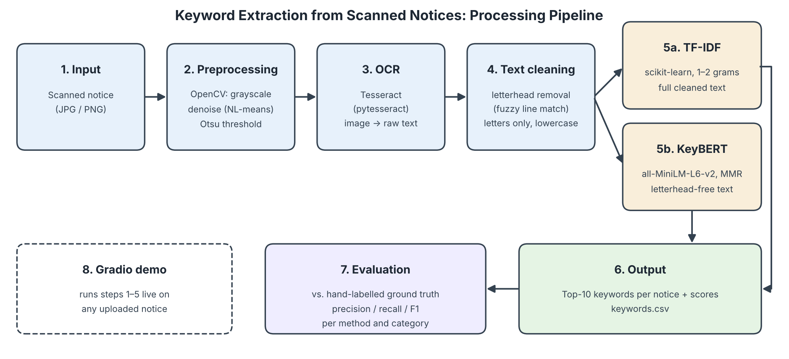
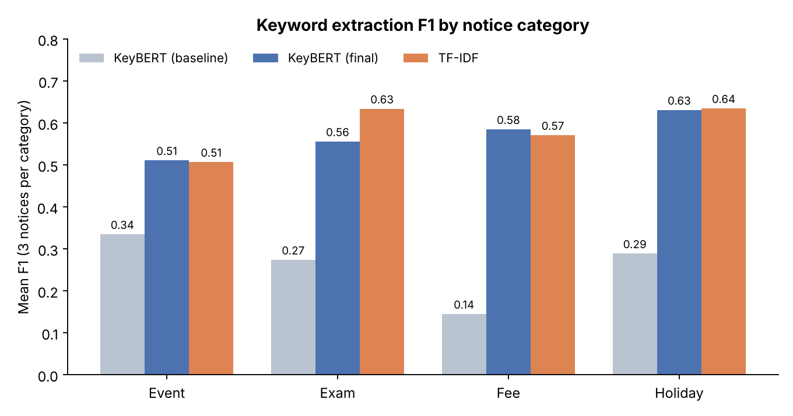
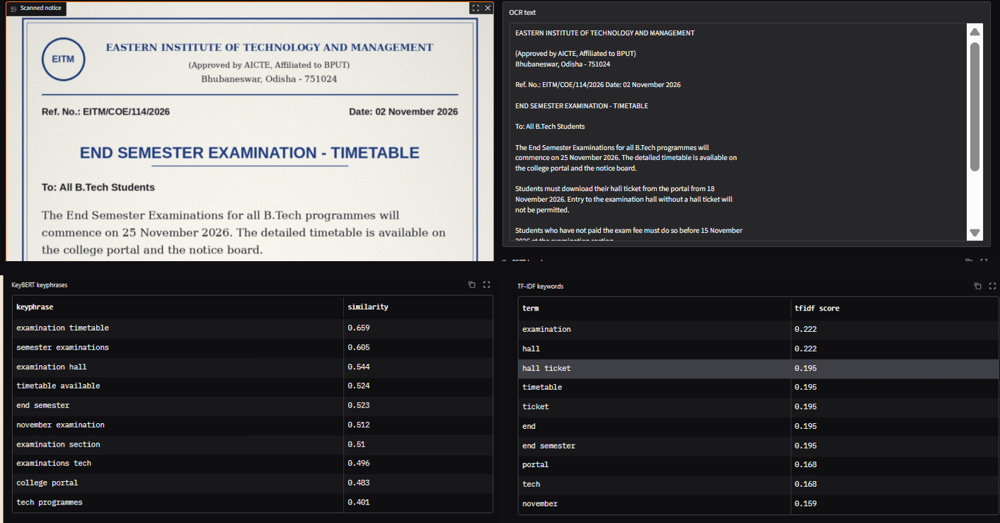
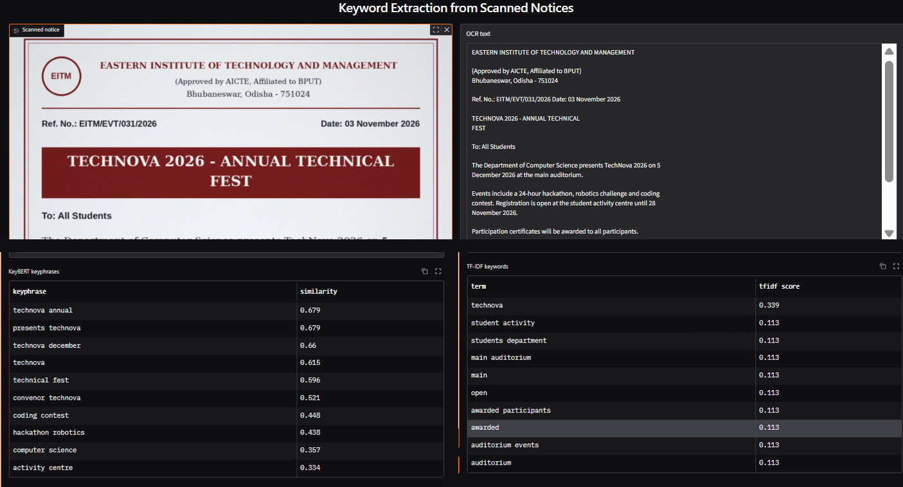

# MLLP Project – Keyword Extraction from Scanned Notices

**MLLP Mini Project · Task 13 · Keyword Extraction from Scanned Documents**

## Overview

This project automatically extracts important keywords from scanned academic notices using Optical Character Recognition (OCR) and Natural Language Processing (NLP).

It compares two keyword extraction techniques:

- **TF-IDF:** A statistical approach that scores words that are frequent in one notice but rare across the others.
- **KeyBERT:** A semantic approach that uses sentence embeddings to find the phrases closest in meaning to the whole notice.

Both techniques are evaluated against hand-labelled ground-truth keywords, and an interactive Gradio web interface lets anyone upload a notice and see its keywords.



## Objectives

- Extract text from scanned notice images using OCR.
- Clean the extracted text and remove recurring letterhead information.
- Identify important keywords using TF-IDF and KeyBERT.
- Compare both methods using Precision, Recall and F1-score.
- Evaluate performance across different notice categories.
- Build an interactive interface for keyword extraction.

## Results

Mean over 12 notices:

| Method | Setup | Precision | Recall | F1 |
|---|---|---|---|---|
| TF-IDF | 1–2 grams, full cleaned text | 0.671 | 0.535 | **0.587** |
| KeyBERT (baseline) | full text incl. letterhead, no MMR | 0.238 | 0.292 | 0.261 |
| KeyBERT (final) | letterhead removed, MMR diversity 0.3 | 0.502 | 0.676 | **0.571** |

**Key finding:** in the first run, KeyBERT's top phrases were the letterhead (*eastern institute*, *bhubaneswar odisha*), because the letterhead appears on every notice. Removing lines that appear in at least 50% of notices (fuzzy-matched at 85% to catch OCR errors) and adding MMR more than doubled KeyBERT's F1. TF-IDF is more precise; KeyBERT finds more of the true keywords and returns readable phrases.



| Category | KeyBERT (baseline) | KeyBERT (final) | TF-IDF |
|---|---|---|---|
| Event | 0.335 | 0.511 | 0.507 |
| Exam | 0.274 | 0.556 | 0.634 |
| Fee | 0.145 | 0.585 | 0.571 |
| Holiday | 0.289 | 0.631 | 0.635 |

## Technologies and Models Used

| Technology | Purpose | Link |
|---|---|---|
| Python | Core programming language | https://www.python.org |
| OpenCV | Image preprocessing | https://opencv.org |
| Tesseract OCR + Pytesseract | Text extraction from images | https://github.com/tesseract-ocr/tesseract |
| Scikit-learn | TF-IDF (`TfidfVectorizer`) | https://scikit-learn.org |
| KeyBERT | Semantic keyword extraction (MMR) | https://github.com/MaartenGr/KeyBERT |
| Sentence Transformers – `all-MiniLM-L6-v2` | 384-dim text embeddings (Hugging Face) | https://huggingface.co/sentence-transformers/all-MiniLM-L6-v2 |
| Pandas | Data processing | https://pandas.pydata.org |
| Matplotlib | Performance visualization | https://matplotlib.org |
| Gradio | Interactive web interface | https://www.gradio.app |
| Google Colab | Development environment (CPU) | https://colab.research.google.com |

No model is trained: all models are used pretrained.

## Project Workflow

1. **Image Upload:** Upload the scanned notice images and the ground-truth XLSX file.
2. **OCR Processing:** Convert images to grayscale, remove noise (non-local means), apply Otsu thresholding and extract text using Tesseract.
3. **Text Cleaning:** Remove recurring letterhead lines (fuzzy matching, 85%), keep letters only and convert to lowercase.
4. **Keyword Extraction:**
   - TF-IDF (1–2 grams) on the full cleaned text.
   - KeyBERT (`all-MiniLM-L6-v2`, MMR diversity 0.3) on the letterhead-free text.
5. **Performance Evaluation:** Split keywords into words (stopwords and digits removed) and compare with the ground truth using Precision, Recall and F1-score.
6. **Visualization:** Generate category-wise F1 comparisons.
7. **Deployment Interface:** Gradio app with a public `gradio.live` link for processing any single notice.

## Dataset

12 scanned academic notices in [`data/notices/`](data/notices), 3 in each of 4 categories:

| Category | Examples |
|---|---|
| Exam | timetable, results, practicals |
| Fee | tuition, hostel, scholarship |
| Holiday | Christmas, winter, Guru Nanak Jayanti |
| Event | tech fest, guest lecture, sports meet |

Ground truth: [`data/ground_truth_keywords.xlsx`](data/ground_truth_keywords.xlsx), with 6–7 hand-labelled keywords per notice.

| Column | Description |
|---|---|
| file | Notice image filename |
| category | Notice category |
| truth | Hand-labelled ground-truth keywords |

The notebook also accepts the column aliases `file name` and `keywords`.

## Sample Input and Output

**Input:** `notice1.jpg` (End Semester Examination – Timetable)

| | Keywords |
|---|---|
| Ground truth | end semester examination, timetable, 25 november 2026, hall ticket, exam fee, controller of examinations |
| TF-IDF | examination, hall, hall ticket, timetable, ticket, end, end semester, portal, tech, november |
| KeyBERT | examination timetable, semester examinations, examination hall, timetable available, end semester, november examination, examination section, examinations tech, college portal, tech programmes |



**Input:** `notice10.jpg` (TechNova 2026 – Annual Technical Fest)

| | Keywords |
|---|---|
| Ground truth | technova 2026, technical fest, hackathon, registration, 5 december 2026, main auditorium, certificates |
| TF-IDF | technova, student activity, students department, main auditorium, main, open, awarded participants, awarded, auditorium events, auditorium |
| KeyBERT | technova annual, presents technova, technova december, technova, technical fest, convenor technova, coding contest, hackathon robotics, computer science, activity centre |

KeyBERT repeats the dominant word (*technova* in 5 of 10 phrases); TF-IDF gives 9 of its 10 terms the same score (0.113), so their order is arbitrary.



More examples: [`Input-Output Results.pdf`](Input-Output%20Results.pdf) and [`outputs/keywords.csv`](outputs/keywords.csv).

## Generated Outputs

Saved in [`outputs/`](outputs):

- `keywords.csv` – Final TF-IDF and KeyBERT keywords per notice.
- `baseline_keywords.csv` – First run, before letterhead removal.
- `evaluation_results.csv` – Per-notice Precision, Recall and F1.
- `evaluation_summary.csv` – Mean scores per method.
- `f1_by_category_colab.png` – Category-wise F1 chart produced by the notebook.

## How to Run

1. Open [`MLLP_Project_Code.ipynb`](MLLP_Project_Code.ipynb) in [Google Colab](https://colab.research.google.com) (File → Upload notebook, or open it from GitHub).
2. Click **Runtime → Run all**. The first cell installs the dependencies and Tesseract OCR.
3. When the upload box appears, select **all 12 images from `data/notices/` and `data/ground_truth_keywords.xlsx` together**.
4. The notebook prints the OCR text, keywords and evaluation tables, and downloads the output files.
5. The last cell starts the Gradio demo and prints a public `gradio.live` link. Upload any notice to see its keywords.

## Installation (to run locally)

```bash
pip install -r requirements.txt
sudo apt-get install tesseract-ocr     # Linux; on Windows install Tesseract and add it to PATH
```

## Repository Structure

```
├── README.md
├── MLLP_Project_Code.ipynb          # full pipeline (Google Colab)
├── requirements.txt
├── MLLP_Mini-Project_Report.pdf     # project report
├── MLLP_PPT_Presentation.pptx       # presentation slides
├── Input-Output Results.pdf         # sample inputs and outputs
├── data/
│   ├── notices/                     # notice1.jpg … notice12.jpg
│   └── ground_truth_keywords.xlsx
├── outputs/                         # keywords and evaluation CSVs, F1 chart
└── docs/                            # block diagram, F1 chart, demo screenshots
```

## Limitations

- Small dataset (12 notices from one institute): the results show trends, not statistically firm conclusions.
- Clean digital scans only; phone photos would give more OCR errors.
- Cleaning keeps only letters, so dates and amounts (e.g. *Rs. 18,500*) cannot become keywords.
- The word-overlap metric is lenient, because phrases are split into single words.
- The letterhead fix was chosen after seeing results on the same 12 notices, with no separate test set, so the final KeyBERT score may be slightly optimistic.
- English only; tables and multi-column layouts are not handled.

## Future Improvements

- Extract dates and fee amounts with named-entity recognition or regex.
- Hybrid method: TF-IDF proposes candidates, KeyBERT ranks them.
- Stronger MMR diversity so KeyBERT stops repeating one word.
- Test on 100+ real notices, including phone photos, with a separate test split.
- Hindi and Odia OCR with a multilingual embedding model.

## Presentation and Demo Video

▶️ [Watch the video](https://drive.google.com/file/d/1IqWBYf7Wyr79DL2a1_Tb96jweYh3c1wC/view?usp=sharing)

## Group Members and Contributions

| Name | Roll Number | Contribution |
|---|---|---|
| Karan Buragohain | 2304024 | Coding, Implementation |
| Bikash Pradhan | 2304020 | Dataset, Report |
| Ayushmaan Nath | 2304019 | PPT, Presentation |

## References

1. Smith, R. (2007). *An Overview of the Tesseract OCR Engine.* ICDAR.
2. Grootendorst, M. (2020). *KeyBERT: Minimal keyword extraction with BERT.* https://github.com/MaartenGr/KeyBERT
3. Reimers, N., & Gurevych, I. (2019). *Sentence-BERT: Sentence Embeddings using Siamese BERT-Networks.* EMNLP.
4. Pedregosa, F. et al. (2011). *Scikit-learn: Machine Learning in Python.* JMLR 12.
5. Otsu, N. (1979). *A Threshold Selection Method from Gray-Level Histograms.* IEEE Trans. SMC.
